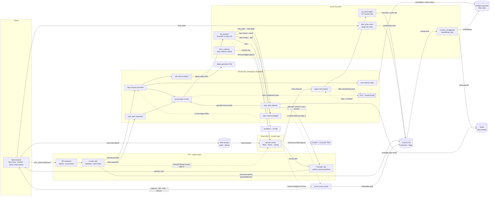

# Memorywell — Event Catalog

Central reference for every event, trigger, and message path in the project:
**who emits it, who consumes it, and why it exists.** `docs/PLAN.md` § Architecture
is the source of truth for _what_ the architecture is; this file is the index that
keeps emitter/consumer/purpose in one place. Update this file in the same PR as any
change that adds, renames, or re-wires an event, subscription, queue, or trigger.

Status legend: **built** (provisioned in Azure), **stub** (handler exists, logic
later), **planned** (designed in a phase brief, not yet created).

---

## Expected flow (diagram)

The whole catalog as one picture: events ride labeled arrows between the two
buses (shaded boxes) and their consumers. **Solid** = flow defined in
`PLAN.md` / phase briefs (some phases still future); **dashed** = unresolved —
see § Open gaps.

The DLQ path is drawn only for the `transcription` queue and `guardian-review`
subscription to keep the graph readable — every queue and subscription behaves
the same way.

---

## Naming conventions

- **Topics**: one Service Bus topic per event, named `{domain}.{event}`
  (`memory.recorded`, `alias.requested`, …). Chosen over a single `memory-events`
  topic with correlation filters so each event routes to purpose-named
  subscriptions without SQL filters and can scale/retire independently.
- **Subscriptions**: named by consumer purpose, not event: `memory-writer`,
  `memory-digest`, `guardian-review`.
- **Queues**: named by job purpose: `transcription`.
- **Event Grid event types** reuse the same `{domain}.{event}` ids; the `subject`
  carries the resource path (e.g. `chronicles/<id>/memories/<id>`).
- **Naming resolved (2026-10-19)**: earlier drafts said queue `transcription-jobs`
  and topic `memory-events` / sub `guardian-sub`. The as-built names in
  `infra/modules/servicebus.bicep` win (deployed + verified in Phase 3 · step 1);
  `step-1.md` / `step-4.md` were corrected to match.

---

## Service Bus — namespace `sb-<base>-<env>` (Standard) — **built**

Source: `infra/modules/servicebus.bicep`. Every queue and subscription has a DLQ
(`maxDeliveryCount: 10`, `deadLetteringOnMessageExpiration: true`).

| Topic / queue             | Subscription      | Emitter                                                    | Consumer                                                                                        | Purpose                                                                                                                               | Status                    |
| ------------------------- | ----------------- | ---------------------------------------------------------- | ----------------------------------------------------------------------------------------------- | ------------------------------------------------------------------------------------------------------------------------------------- | ------------------------- |
| `memory.recorded` (topic) | `memory-writer`   | Curator agent (`api/curator.py`) after canonical write     | embedding/index worker (Curator-side, Phase 4b)                                                 | Refresh vector/search artifacts for the new memory                                                                                    | stub (P3) → logic in 4b   |
| `memory.recorded`         | `memory-digest`   | ″                                                          | digest generator (Phase 8)                                                                      | Roll up recent memories into periodic contributor digests                                                                             | planned (P8)              |
| `memory.recorded`         | `guardian-review` | ″                                                          | `functions/sb_guardian` (Safety/quality/duplicate scoring → writes `flag`)                      | Human-in-loop flagging: Guardian scores every new memory and emits `memory.flagged` on create only                                    | stub (P3) → logic in 4c   |
| `memory.flagged` (topic)  | _(none yet)_      | Guardian agent (Phase 4c)                                  | owner review queue (web/API)                                                                    | Deliver flagged memories to owners for approve/edit/hide/dismiss; stores `resolvedBy` audit                                           | **gap — see § Open gaps** |
| `alias.requested` (topic) | `guardian-review` | Curator agent (alias-intent extraction on any submission)  | Guardian alias validation (Phase 4c)                                                            | Validate an own-alias change (uniqueness, appropriateness, own-alias-only) before it is applied                                       | stub (P3) → logic in 4c   |
| `alias.updated` (topic)   | `guardian-review` | Guardian agent, on validation pass (auto-apply)            | _(built: guardian-review; planned: Redis cache invalidation + Prompter next-turn confirmation)_ | Propagate an applied alias so caches invalidate and the next prompt addresses the contributor by the new alias (`Got it, Granny — …`) | stub (P3) → logic in 4c   |
| `transcription` (queue)   | — (queue)         | API voice-pipeline (Phase 6; manual publish for P3 checks) | `functions/sb_transcription`                                                                    | One Service Bus message per voice note → speech-to-text job → transcript + audio linked in the timeline                               | stub (P3) → logic in 6    |

Agents never call each other directly; this topic/queue fan-out plus Cosmos state
is the only coordination path (AGENTS.md domain invariant).

---

## Event Grid — custom topic `evg-<base>-<env>` — **planned** (Phase 3 · step 2)

Source: `docs/phase-3/step-2.md`. Custom topic for app domain events, subscriptions
with `includedEventTypes` / `subjectBeginsWith` filters, retry policy, dead-letter
to a storage container for failed deliveries.

**Routing model (working assumption — confirm at the Phase 3 review gate):**
emitters publish domain events to the Event Grid topic; each event subscription
routes with filters either (a) directly to a Function endpoint (webhook-style) or
(b) bridged into a Service Bus topic (e.g. `memory-recorded-to-sb`) for durable
fan-out + DLQ before Function consumption. Event Grid = filtering/retries/routing;
Service Bus = queueing/fan-out/DLQ. If instead emitters publish to both buses,
record that decision here.

| Event type        | Emitter                                         | Consumer(s)                                                              | Purpose                                                                                        | Status    |
| ----------------- | ----------------------------------------------- | ------------------------------------------------------------------------ | ---------------------------------------------------------------------------------------------- | --------- |
| `checkin.due`     | `functions/timer_cadence` (daily cadence sweep) | Prompter question generation (Phase 4a)                                  | Fire scheduled check-ins that respect per-(chronicle, contributor) cadence (`none` suppresses) | stub (P3) |
| `voice.received`  | API after voice blob upload (Phases 5–6)        | routing into `transcription` queue → `sb_transcription`                  | Kick off speech-to-text for a new voice note                                                   | planned   |
| `memory.archived` | _undefined — see § Open gaps_                   | _undefined — see § Open gaps_                                            | Refresh derived views/digests when an owner archives a memory                                  | planned   |
| `memory.recorded` | Curator agent                                   | `memory-recorded-to-sb` bridge → Service Bus topic (fan-out below)       | Cross app-domain event into the worker fan-out (embeddings / digest / guardian)                | planned   |
| `memory.flagged`  | Guardian agent                                  | `memory-flagged-to-review` → owner review queue Function                 | Same flag event, routed to the review surface instead of the worker fan-out                    | planned   |
| `alias.requested` | Curator agent                                   | bridged → `alias.requested` topic → `guardian-review`                    | Same as Service Bus row — routed through Event Grid filters first                              | planned   |
| `alias.updated`   | Guardian agent (on pass)                        | bridged → `alias.updated` topic → `guardian-review` + cache invalidation | Same as Service Bus row                                                                        | planned   |

---

## Non-message triggers & paths (Functions) — **planned/stub** (Phase 3)

| Trigger / path                 | Handler                       | Emitter / source                 | Purpose                                                                                                   | Status          |
| ------------------------------ | ----------------------------- | -------------------------------- | --------------------------------------------------------------------------------------------------------- | --------------- |
| Timer (daily)                  | `functions/timer_cadence`     | Azure Functions schedule         | Cadence sweep per (chronicle, contributor); emits `checkin.due` when due (real filtering in Phase 4a)     | stub (P3)       |
| Cosmos change feed             | `functions/cosmos_changefeed` | `memories` container change feed | Embedding generation + cache refresh on new/updated memories (Phase 4b)                                   | stub (P3)       |
| HTTP `POST /api/invites/claim` | `functions/http_invite_claim` | web invite magic link            | Claim invite → write household membership; returns Event Grid `validationCode` handshake for its endpoint | stub (P3)       |
| DLQ monitor / resubmit         | script or Function + alert    | any queue/subscription DLQ       | Peek failed messages, re-send after fix; alert on DLQ depth (alerting wired in Phase 7)                   | documented (P3) |

DLQ philosophy: bounded redelivery (`maxDeliveryCount`) + explicit resubmit path,
not retry-forever — a poison message must never block the queue. Commands:
`az servicebus queue message peek`, resubmit via `az servicebus ... message send`
after fixing the cause (exact commands documented in Phase 3 · step 4).

---

## Open gaps (resolve during Phase 3/4, then delete from this list)

1. **`memory.flagged` has zero subscriptions** — `servicebus.bicep` defines the
   topic with `subs: []`. Planned consumer is the owner review queue; either add a
   subscription (Phase 4c/5) or route `memory-flagged-to-review` via Event Grid.
2. **Dual-bus model unconfirmed** — PLAN §3 lists the same four events on both
   Service Bus and Event Grid. Confirm the routing model (Event Grid entry +
   `*-to-sb` bridge, vs publish-to-both) at the Phase 3 review gate and update the
   Event Grid section above.
3. **`memory.archived` is undefined** — no emitter or consumer anywhere in PLAN or
   the phase briefs. Decide the owner-archive flow before Phase 5, or drop the
   event type from the Event Grid list.
4. **Embedding generation listed twice** — Cosmos change feed trigger (PLAN §2/§3)
   _and_ the `memory-writer` subscription on `memory.recorded` (PLAN §3). Confirm
   which is canonical (likely change feed; `memory-writer` may be retired or
   repurposed for digest-adjacent writes).
5. **`guardian-review` attached to `alias.updated`** — built as such; intended
   consumers are cache invalidation + Prompter confirmation. Confirm Guardian
   re-consuming its own event is just observability, or detach.
